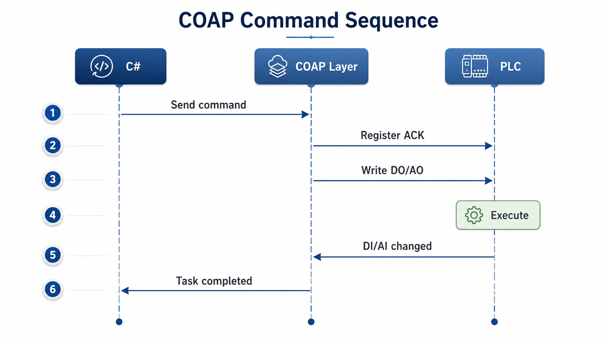

# CoapClient

[English](README.md) | [中文](README_CN.md)

COAP means **Command Oriented Ads Protocol**.

CoapClient is a command-oriented C# middleware for Beckhoff TwinCAT ADS.

It turns the common PLC interaction pattern of "write DO/AO, then poll DI/AI" into an asynchronous command lifecycle based on ADS notifications.

> Note: this project is not an implementation of the IETF CoAP protocol. In this project, COAP stands for Command Oriented Ads Protocol.

> Since 0.4.x the client exposes connection state, a 1-second heartbeat, automatic reconnect and `IDisposable`. `Connected` requires a reachable ADS transport, a loaded symbol table and the PLC in `Run`.

## Command Sequence

The sequence below shows how CoapClient prepares the ACK observation path before writing the command variable, then completes the command when the PLC publishes the expected ACK.



## Why This Project Exists

In many upper-level automation applications, one complete action is modeled like this:

1. The C# application writes a DO/AO variable to start an action.
2. A PLC task executes the action.
3. The PLC updates a DI/AI variable to expose the result.
4. The C# application repeatedly reads the DI/AI variable until it reaches the expected value or times out.

That works, but it pushes polling, timeout checks, command collision handling, and notification timing issues into every caller.

CoapClient wraps this into a command model:

```text
Create command
-> register DI/AI notification
-> complete notification handshake
-> write DO/AO
-> receive ADS notification
-> validate ACK
-> clean up notification handle
-> complete the command task
```

The caller describes what should be written and what ACK condition should be observed. CoapClient manages the lifecycle.

## Design Goal

CoapClient is designed for PLC workflows that can be expressed as:

```text
DO/AO starts a command.
DI/AI represents the command result.
```

It is especially useful when upper-level software should issue commands without manually implementing DI/AI polling loops.

## Communication Flow

For a command with ACK, CoapClient follows this flow:

| Step | Behavior | Purpose |
|---|---|---|
| 1 | Register a notification handle for the ACK DI/AI variable | Observe the result before sending the command |
| 2 | Wait for the first notification frame or actively read the value | Avoid losing the initial handshake under high load |
| 3 | Write the DO/AO command variable | Start the PLC action only after the ACK path is ready |
| 4 | PLC executes the action | Handled by the PLC task |
| 5 | PLC changes the DI/AI result variable | Triggers ADS `OnChange` notification |
| 6 | CoapClient validates the ACK predicate | Decide whether the command succeeded |
| 7 | Remove the notification handle | End the command lifecycle |
| 8 | If timeout occurs, actively read the ACK once more | Reduce false timeouts caused by notification timing edges |

The handshake step is important. Under high load, the first notification frame after registering a handle may be missed. CoapClient actively reads the ACK variable during registration and again after timeout to keep the command lifecycle as complete as possible.

## Quick Start

```csharp
using CoapClient;

var client = new SimpleCoapClient();
client.Connect("YOUR_AMS_NET_ID", 851);

var write = new VariableWriteItem("PC_GVAR.DO_TO_POS", true);
var ack = new AckPredicate<bool>(
    "PC_GVAR.DI_AT_POS",
    PredicateType.Equals,
    true);

var command = new CoapCommandItem(write, ack);

object result = await client.SendAndWaitAck(
    command,
    TimeSpan.FromSeconds(3));
```

This command means:

```text
Write PC_GVAR.DO_TO_POS = true.
Listen to PC_GVAR.DI_AT_POS.
Complete the command when PC_GVAR.DI_AT_POS == true.
Timeout after 3 seconds.
```

## Timeouts

Every ACK-required command has a timeout. The value is resolved in this order:

```text
1. the timeSpan argument passed to SendAndWaitAck
2. ICoapCommand.Timeout, when the command supplies one
3. SimpleCoapClient.DefaultAckTimeout  — currently 1 minute
```

The third step matters: `CoapCommandItem` and `CoapSumCommandItem` do **not** populate
`ICoapCommand.Timeout`, so omitting `timeSpan` falls through to `DefaultAckTimeout`. If you
need a different bound, either pass `timeSpan` explicitly or derive from `AbstractCoapCommand`
and set `Timeout` in your own constructor.

Commands without an ACK (`AckRequired == false`) are never scheduled for timeout — they complete
as soon as the write is dispatched.

## Cancellation

`SendAndWaitAck` accepts an optional `CancellationToken`. When the token is signalled, the command task completes as cancelled instead of waiting for the ACK or the timeout.

If the token is already cancelled when `SendAndWaitAck` is called, the returned task is cancelled immediately without touching the PLC.

```csharp
using System.Threading;
using CoapClient;

var client = new SimpleCoapClient();
client.Connect("YOUR_AMS_NET_ID", 851);

var write = new VariableWriteItem("PC_GVAR.DO_TO_POS", true);
var ack = new AckPredicate<bool>("PC_GVAR.DI_AT_POS", PredicateType.Equals, true);
var command = new CoapCommandItem(write, ack);

using var cts = new CancellationTokenSource(TimeSpan.FromSeconds(3));
try
{
    object result = await client.SendAndWaitAck(command, cancellationToken: cts.Token);
    Console.WriteLine($"Command completed: {result}");
}
catch (OperationCanceledException)
{
    Console.WriteLine("Command was cancelled.");
}
```

Cancellation is cooperative: CoapClient stops waiting and unregisters the notification handle, but it does not undo the DO/AO write already sent to the PLC.

Note this example relies on the `CancellationTokenSource` to bound the wait — it does not pass
`timeSpan`. Without the token, the command would time out after `DefaultAckTimeout` instead.

## Public API

### SimpleCoapClient

Main entry point for callers.

| Member | Description |
|---|---|
| `Connect(string amsNetId, int amsPort)` | Connects to the TwinCAT ADS server and loads the symbol table. |
| `Task<object> SendAndWaitAck(ICoapCommand command, TimeSpan? timeSpan = null, CancellationToken cancellationToken = default)` | Sends a command and returns a task that completes when the ACK is satisfied, fails, collides, is cancelled, or times out. |
| `bool VariableExists(string varName)` | Checks whether a PLC variable exists, using the locally cached symbol table. No ADS round trip. |
| `object GetVariableValue(string varName)` | Reads a PLC variable value directly. |
| `ISymbol? GetVariableSymbol(string varName)` | Looks up a PLC variable's symbol metadata — declared type, type category, byte size, members. Local lookup, no ADS round trip. Returns `null` when the variable does not exist. |
| `object[] GetSumVariableValue(string[] varNames)` | Reads several PLC variable values in a single ADS sum read; the result aligns with `varNames`. |
| `string GetServerStatusString()` | Returns the last known PLC state; when the transport is unavailable it returns the COAP state name (for example `Recovering`). No live ADS round trip. |
| `CoapConnectionState ConnectionState` | Current COAP connection state. |
| `CoapConnectionSnapshot ConnectionSnapshot` | Immutable snapshot (state, symbol table, generation, PLC state, last error). |
| `AdsState? LastKnownPlcState` | Last known PLC `AdsState`. |
| `event EventHandler<CoapConnectionStateChangedEventArgs> ConnectionStateChanged` | Raised when the connection state changes. |
| `void Dispose()` | Stops heartbeat/reconnect, queues and timeout scheduler, faults in-flight commands and releases the ADS session. |
| `static readonly TimeSpan DefaultAckTimeout` | Fallback ACK timeout, currently 1 minute. See [Timeouts](#timeouts). |

Parameter validation: `SendAndWaitAck` throws `ArgumentNullException` when `command` is `null`,
and `ArgumentException` when the command requires an ACK but its `AckVarName` is null or empty.
Both are thrown **before** the cancellation check, so a malformed command fails loudly even when
the token is already cancelled.

Batch read in one ADS round-trip:

```csharp
object[] values = client.GetSumVariableValue(
    new[] { "PC_GVAR.DI_AT_POS", "PC_GVAR.AI_PRESSURE" });
bool atPos = (bool)values[0];
```

### Connection state and reconnect

`SimpleCoapClient` probes the ADS state once per second in the background and reconnects automatically after a loss.

| State | Meaning |
|---|---|
| `Disconnected` | Not connected yet, or the initial connect failed. |
| `Connecting` | The initial `Connect` is running. |
| `Connected` | ADS reachable, symbol table loaded, PLC in `Run`. |
| `Recovering` | Transport lost, or the PLC is reachable but not in `Run`; retrying with backoff. |
| `Disposed` | `Dispose` has been called. |

**Publishing order is an invariant**: the symbol table is rebuilt and the snapshot is swapped atomically before `Connected` is published and the event is raised. A handler can therefore use the symbol table safely. While not `Connected`, symbol lookups throw `CoapNotConnectedException` and `SendAndWaitAck` returns a faulted task.

```csharp
client.ConnectionStateChanged += (sender, e) =>
{
    Console.WriteLine($"{e.OldState} -> {e.NewState} (generation {e.Generation})");
};

if (client.ConnectionState == CoapConnectionState.Connected)
{
    bool exists = client.VariableExists("PC_GVAR.DI_AT_POS");
}
```

Recovery behavior:

- A loss moves the client to `Recovering` and retries with 1s → 2s → 5s backoff.
- Recovery disposes the old `AdsSession`, creates a fresh one, reloads the symbol table and then publishes `Connected`.
- When the PLC is reachable but in `Stop`/`Config`, the client stays in `Recovering` and does not tear down the transport repeatedly.
- The 21-second FailFast window is retained: calls after a loss fail fast instead of waiting for the 5-second ADS timeout.
- **In-flight commands are never replayed automatically.** They end through their own timeout; notifications, symbol references and handles from the previous generation are dropped so they cannot affect commands on the new connection.
- One client instance maps to one AMS target. A second `Connect` to the same target returns immediately; a different target throws `InvalidOperationException`. A failed initial connect is not retried automatically.

### Checking whether a variable exists

`VariableExists` answers whether a variable name is known to the PLC, using only the
locally cached symbol table — no ADS round trip per call. Check as many names as needed
by calling it repeatedly.

```csharp
if (!client.VariableExists("PC_GVAR.DO_TO_POS"))
{
    Console.WriteLine("Variable is not part of the current PLC project.");
}
```

Behavior and constraints:

| Case | Result |
|---|---|
| Variable exists in the loaded symbol table | `true` |
| Variable does not exist | `false` |
| `varName` is null, empty, or whitespace | throws `ArgumentException` |
| The client is not `Connected` (not connected yet, reconnecting, or PLC not in `Run`) | throws `CoapNotConnectedException` |

The symbol table is loaded during `Connect` and **rebuilt after every successful reconnect**.
It is not refreshed while the connection stays up: after a PLC re-download or an Online Change,
wait for a reconnect (or reconnect explicitly) before relying on the check. A stale table can
otherwise report a variable that no longer exists.

### Reading a variable's type

`GetVariableSymbol` returns the symbol metadata for a variable — the same local lookup as
`VariableExists`, but it hands back the symbol instead of a boolean.

```csharp
ISymbol? symbol = client.GetVariableSymbol("PC_GVAR.DI_AT_POS");
if (symbol is null)
{
    Console.WriteLine("Variable is not part of the current PLC project.");
    return;
}

symbol.TypeName               // "BOOL"  — the declared PLC type name
symbol.ByteSize               // 1
symbol.DataType.Category      // DataTypeCategory.Primitive
symbol.DataType.IsPrimitive   // true
symbol.SubSymbols             // members, for struct and array types
```

To get the .NET equivalent of the PLC type, hand `symbol.DataType` to the TwinCAT ADS resolver:

```csharp
// using TwinCAT.TypeSystem;
DataTypeResolverExtension.TryGetManagedType(symbol.DataType, out Type? managed);
```

Behavior matches `VariableExists`: the variable does not exist returns `null`, a null/empty name
throws `ArgumentException`, and calling it while not `Connected` throws `CoapNotConnectedException`.

Two things to keep in mind:

- **The returned `ISymbol` is a live reference into the symbol table, not a copy.** Treat it as
  read-only.
- **Type information belongs to the current connection generation.** Every successful reconnect
  rebuilds the symbol table; an `ISymbol` obtained before the reconnect becomes stale. Do not
  cache it across `ConnectionStateChanged`. An Online Change while the connection stays up is not
  refreshed automatically; wait for a reconnect before relying on it.

This API is a query only. It does not participate in the command lifecycle — it cannot affect,
and is not affected by, `SendAndWaitAck`.

### VariableWriteItem

Represents one PLC variable write.

```csharp
var item = new VariableWriteItem("PC_GVAR.DO_TO_POS", true);
```

| Member | Description |
|---|---|
| `VarName` | PLC variable name to write. |
| `Value` | Value to write. |

### ICoapCommand

The contract `SendAndWaitAck` operates on. Implement it directly, or derive from
`AbstractCoapCommand` (recommended — see below).

| Member | Description |
|---|---|
| `bool AckRequired` | `false` makes the command fire-and-forget: the write is dispatched and the task completes immediately, with no notification, no ACK check and no timeout. |
| `string AckVarName` | The DI/AI variable observed for the result. Required when `AckRequired` is `true`. |
| `int CycleTime` | Interval, **in milliseconds**, at which the ADS server samples the ACK variable for changes. Passed to `NotificationSettings`. |
| `int MaxDelayTime` | Maximum delay, **in milliseconds**, passed to `NotificationSettings`. `0` disables the mechanism. |
| `TimeSpan? Timeout` | Optional per-command ACK timeout. Used when `SendAndWaitAck` is called without `timeSpan`. |
| `Type ValueType` | Declared for type information. Not currently populated or read by the library — treat it as unused. |
| `bool ValidateAck(byte[] rawAckData)` | Returns whether the raw ACK bytes satisfy the command's condition. |
| `object GetResult(byte[] rawData)` | Converts the raw ACK bytes into the object returned by `SendAndWaitAck`. |

> `CycleTime` and `MaxDelayTime` are **milliseconds** here, because they bind to
> `NotificationSettings(AdsTransMode, int, int)`. The raw ADS protocol
> (`AdsNotificationAttrib`) uses 100 ns units instead — do not copy values between the two.

### AbstractCoapCommand

Base class for custom commands. It implements `ICoapCommand` and delegates ACK handling to an
`IAck` instance, so a derived class only has to supply the payload and the properties.

```csharp
public class MyCommand : AbstractCoapCommand
{
    public MyCommand(VariableWriteItem write, IAck ack)
    {
        this.WriteItem = write;
        this.AckPredicate = ack;
        this.AckRequired = true;
        this.AckVarName = ack.AckVarName;
        this.CycleTime = 2;
        this.MaxDelayTime = 0;
        this.Timeout = TimeSpan.FromSeconds(5);   // protected set
    }

    public VariableWriteItem WriteItem { get; }
}
```

| Member | Description |
|---|---|
| `AckPredicate` | The `IAck` used by `ValidateAck` / `GetResult`. |
| `AckRequired`, `CycleTime`, `MaxDelayTime`, `AckVarName`, `Timeout` | `protected set`, so a derived class can populate them. |
| `ValidateAck(byte[])` | Returns `true` when `AckRequired` is `false`; otherwise delegates to `AckPredicate.IsMatched`. |
| `GetResult(byte[])` | Returns `true` when `AckRequired` is `false`; otherwise delegates to `AckPredicate.GetResultWithType`. |

### CoapCommandItem

Single-variable command, derived from `AbstractCoapCommand`.

```csharp
// ack omitted (or null) => AckRequired stays false => fire-and-forget
var command = new CoapCommandItem(writeItem);

// with ACK; cycleTime defaults to 2 ms
var command = new CoapCommandItem(writeItem, ack);
var command = new CoapCommandItem(writeItem, ack, cycleTime: 10);
```

Passing `null` for `ack` is the supported way to issue a write without waiting for a result.

### CoapSumCommandItem

Multi-variable write command, dispatched via an ADS sum write.

```csharp
var command = new CoapSumCommandItem(
    new[]
    {
        new VariableWriteItem("PC_GVAR.DO_A", true),
        new VariableWriteItem("PC_GVAR.DO_B", false),
    },
    ack);
```

Same three constructor forms as `CoapCommandItem`, including the optional `cycleTime`.

The written variables must all be distinct — a repeated variable raises `InvalidOperationException`
at dispatch time.

### IAck

Defines how a command result is checked.

| Member | Description |
|---|---|
| `string AckVarName` | PLC DI/AI variable used as the command result. |
| `bool IsMatched(byte[] rawData)` | Returns whether the raw ACK value satisfies the condition. |
| `object GetResultWithType(byte[] rawData)` | Converts the raw ACK bytes into a typed result. |

Implement `IAck` when the built-in predicate model is not enough.

### AckPredicate<T>

Built-in ACK implementation for unmanaged value types.

```csharp
IAck ack = new AckPredicate<bool>(
    "PC_GVAR.DI_AT_POS",
    PredicateType.Equals,
    true);
```

You can also provide a custom predicate:

```csharp
IAck ack = new AckPredicate<int>(
    "PC_GVAR.AI_PRESSURE",
    value => value >= 10 && value <= 20,
    "pressure in expected range");
```

### PredicateType

| PredicateType | Meaning | Arguments |
|---|---|---|
| `Equals` | ACK value equals the expected value | `arg1` |
| `NotEquals` | ACK value does not equal the expected value | `arg1` |
| `GreaterOrEqual` | ACK value is greater than or equal to the expected value | `arg1` |
| `LessOrEqual` | ACK value is less than or equal to the expected value | `arg1` |
| `InBetween` | ACK value is within a closed interval | `arg1`, `arg2` |

The three ordering predicates require a comparable ACK value type; using them with a value type
that does not support comparison raises `InvalidOperationException`.

## Command Lifecycle

Internally, a command moves through these states:

| State | Meaning |
|---|---|
| Queued | The command has been accepted but not dispatched. |
| HandShakeSent | The ACK notification path is being established. |
| Dispatched | The DO/AO write has been sent to the PLC. |
| Success | The ACK predicate matched. |
| Timeout | The ACK did not match before timeout, including the final active read. |
| Collided | Another command is already using the same ACK variable. |
| Cancelled | The command was cancelled via a `CancellationToken`. |

Only one in-flight command can use the same ACK variable at the same time. This avoids ambiguous notification ownership.

A connection loss is not a command terminal state. In-flight commands are never replayed
automatically; they end through their own timeout. Notifications, symbol references and handles
from the previous generation are dropped by the connection generation guard, so they cannot affect
commands on the new connection.

## Exceptions

`SendAndWaitAck` reports every terminal state through the returned task — either the ACK value,
or one of the exceptions below. Note that a few failures are thrown **synchronously** from the
call itself rather than through the task; see the notes.

| Exception | Meaning |
|---|---|
| `TimeoutException` | The ACK predicate was not satisfied before the timeout. The message carries the last known value. |
| `CoapCommandCollisionException` | Another command already owns this ACK variable. Carries `AckVarName`. |
| `OperationCanceledException` (as `TaskCanceledException`) | The command was cancelled through the `CancellationToken`. |
| `CoapResultConversionException` | **The command succeeded but the task still faulted.** See below. |
| `CoapSymbolNotFoundException` | The variable is not in the loaded symbol table. Carries `VarName`. |
| `CoapNotConnectedException` | The connection is not `Connected` (not connected yet, reconnecting, or PLC not in `Run`). |
| `ObjectDisposedException` | `SimpleCoapClient` has been disposed and a command is still being submitted. |
| ADS exceptions (`AdsErrorException` and friends) | Propagated from the underlying `Beckhoff.TwinCAT.Ads` layer. |

Synchronous throws:

- `SendAndWaitAck` with a `null` command → `ArgumentNullException`.
- `SendAndWaitAck` with a command that requires an ACK but has an empty `AckVarName` → `ArgumentException`.
- `SendAndWaitAck` after `Dispose` → `ObjectDisposedException`.
- `Connect` rethrows whatever the ADS layer reports, unchanged.

### `CoapResultConversionException` — do not retry blindly

This is the one exception that means the command **succeeded**. The ACK predicate was satisfied,
so the PLC-side action has already taken effect — but `ICoapCommand.GetResult` then threw while
turning the raw ACK bytes into a result object.

A caller that treats this as a command failure and re-issues the write will execute the PLC
action a **second time**. Inspect `RawAckData` (the bytes the PLC actually reported) and the
`InnerException` (whatever `GetResult` threw) instead.

```csharp
try
{
    object result = await client.SendAndWaitAck(command);
}
catch (CoapResultConversionException ex)
{
    // The PLC action already happened. Investigate, do not blindly retry.
    Console.WriteLine($"ACK was satisfied ({ex.AckVarName}) but result parsing failed.");
    Console.WriteLine($"Raw ACK bytes: {Convert.ToHexString(ex.RawAckData ?? Array.Empty<byte>())}");
    Console.WriteLine($"Cause: {ex.InnerException?.Message}");
}
catch (CoapCommandCollisionException ex)
{
    Console.WriteLine($"{ex.AckVarName} already has a command in flight.");
}
catch (CoapSymbolNotFoundException ex)
{
    Console.WriteLine($"{ex.VarName} is not part of the current PLC project.");
}
catch (CoapNotConnectedException)
{
    Console.WriteLine("Connection is not ready; wait for ConnectionState == Connected and retry.");
}
```

### Backward compatibility

`CoapCommandCollisionException`, `CoapSymbolNotFoundException` and `CoapNotConnectedException`
all derive from `InvalidOperationException`, so callers written against earlier versions that
caught `InvalidOperationException` keep working. Prefer the specific types in new code — the
base type alone cannot tell these conditions apart.

## Logging

The library logs through **log4net** using its own repository and logger:

```text
repository : CoapProjectRepository
logger     : [COAP]
```

The repository is configured internally, so you do not need to add a log4net configuration to
see library output. `Connect`, command dispatch, ACK validation, handle cleanup, timeout
handling, connection loss and recovery all write log entries; failures are logged before the
exception is propagated.

## Concurrency

- **Different ACK variables** may be used by concurrent commands. Each command owns its own
  notification handle, and the notification callback thread hands work to a single consumer
  queue, so ACK processing for different commands is serialized rather than interleaved.
- **The same ACK variable** cannot have two in-flight commands. The second one fails
  immediately with `CoapCommandCollisionException`.
- Commands without an ACK are dispatched through a serialized sender.
- Heartbeat and reconnect run on a single background loop per client and never race a `Connect`
  against command dispatch.
- `ConnectionStateChanged` is raised synchronously on a background thread. Keep handlers short,
  do not block, and do not call `Connect`/`Dispose` synchronously from inside a handler.

## Lifetime

`SimpleCoapClient` implements `IDisposable`. `Dispose`:

1. publishes `Disposed`;
2. stops heartbeat/reconnect;
3. stops command and notification queues;
4. faults in-flight commands with `ObjectDisposedException`;
5. stops the timeout scheduler;
6. releases the `AdsSession` and its notification handles.

`Dispose` is idempotent and bounded (about 2 seconds). Prefer `using`:

```csharp
using var client = new SimpleCoapClient();
client.Connect("YOUR_AMS_NET_ID", 851);
```

Reuse one client per application where possible; frequent creation/disposal still puts pressure
on ADS ports and handles, and TwinCAT allows roughly 8191 handles in total.

## Project Structure

Paths are relative to the repository root.

| Path | Purpose |
|---|---|
| `CoapClient/CoapClient/` | Library source code. |
| `CoapClient/CoapTestConsole/` | Small console project for manual experiments. |
| `CoapClient/BRIEF.md` | Maintainer notes describing the project intent. |
| `CoapClient/CoapTestConsole/Issue.md` | Known open defects. |
| `CoapClient/CoapTestConsole/CoapClient_KnownIssues.md` | Exception-semantics traps, for downstream consumers. |
| `CoapClient/CoapTestConsole/ReplacementTests.cs` | Hardware smoke tests (connect, commands, reconnect, dispose). |
| `CoapClient/CoapTestConsole/CHANGES_2026-10-28.md` | 2026-10-28 change summary. |

Important internal components:

| Component | Responsibility |
|---|---|
| `ThinAdsServer` | Wraps TwinCAT ADS connection, symbol lookup, read, write, notifications, heartbeat and reconnect. |
| `CoapConnectionState` / `CoapConnectionSnapshot` | Public connection state, immutable snapshot and state-change event. |
| `CommandContext` | Holds one command lifecycle, completion state and connection generation. |
| `CommandSender` | Serializes command dispatch and validates the generation before writing. |
| `CommandHandler` | Handles ADS notifications, drops stale-generation notifications and routes to command contexts. |
| `CommandInFlightManager` | Prevents ACK variable collisions and supports loss/dispose cleanup. |
| `TimeoutScheduler` | Schedules command timeout callbacks. |

`SingleConsumerQueue<T>` and `ITimeoutItem` are implementation details that are currently
declared `public`; do not depend on them. See `Issue.md`.

## Requirements

- .NET 8 SDK
- Beckhoff TwinCAT ADS environment
- Reachable ADS route from the machine running the C# application

The library currently targets `net8.0`.

## Build

```powershell
dotnet restore
dotnet build CoapClient.sln
```

## Roadmap

Planned directions:

- Observation mode: long-lived variable observation outside a single command lifecycle.
- Multi-ACK commands: one command can depend on multiple ACK variables.
- Stronger examples and integration tests around real TwinCAT setups.
- More complete documentation for custom `IAck` implementations.

## Contributing

This project is looking for contributors who have experience with:

- TwinCAT ADS and Beckhoff PLC workflows
- C# async programming
- Industrial automation command models
- Robust timeout and notification handling
- Documentation and examples for real machine-control scenarios

Useful contribution areas:

- Improve the public API ergonomics.
- Add examples for common DO/DI and AO/AI workflows.
- Implement Observation mode.
- Design and implement multi-ACK command support.
- Add tests for command lifecycle edge cases.
- Improve error messages and logging.

Before changing behavior, please keep the core design rule in mind:

```text
The ACK observation path should be ready before the DO/AO command is sent.
```

This rule protects command lifecycle integrity under notification delay or high-load scenarios.
